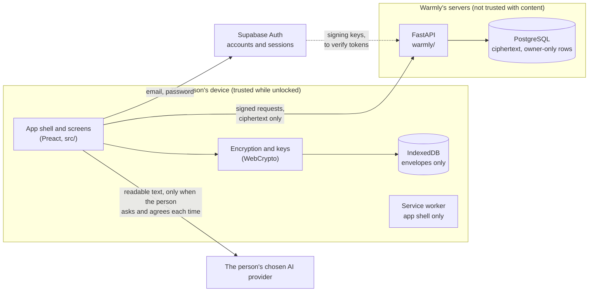
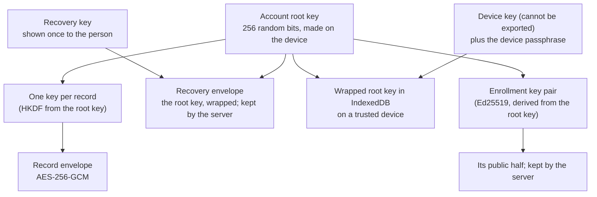
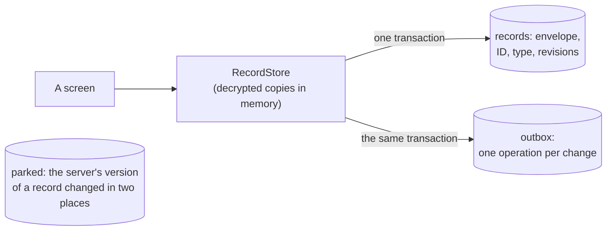
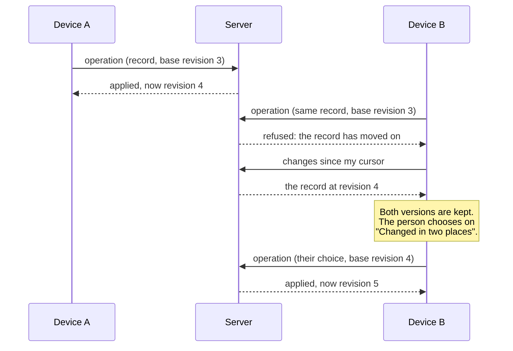
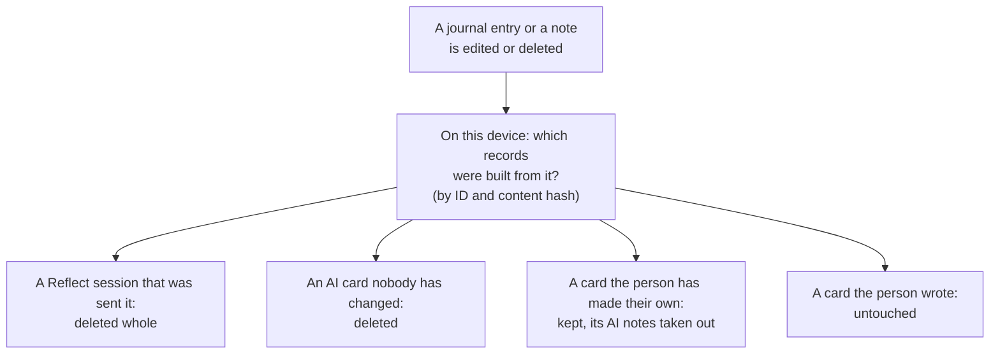
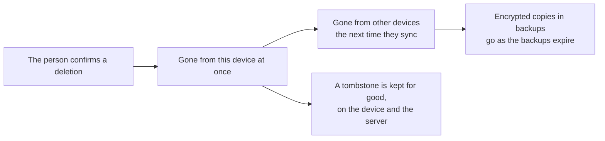

# Architecture overview

Five pictures of how Warmly is put together, each with a pointer to the
decision record that holds the detail. The pictures are summaries. Where
one disagrees with a decision record or with the code, the picture is
wrong: fix it.

The diagrams are written in Mermaid, which GitHub draws.

## 1. The system and its trust boundaries

What runs where, and what crosses each line.

- **Nothing readable reaches Warmly's servers.** Records leave the device
  only as envelopes. The server sees who owns a record, its ID, its type
  number, its revisions, its size and when it changed.
- **Readable text leaves the device in one case only:** to the AI
  provider the person chose, after they asked for something and agreed to
  the disclosure for that request. There is no AI proxy on Warmly's side.
- **Two things identify a request:** the session token (who the account
  is) and a signature by a key that never leaves the device (which device
  is speaking). See [ADR-0005](../adr/0005-device-identity-and-pairing.md).
- The service worker caches the app's own files, never an API response.

Threats and what answers them:
[threat model](../security/threat-model.md).

## 2. Keys, from creation to loss

- **Made** on the device at sign-up. Saved only after the person confirms
  they have the recovery key.
- **Used** while the app is unlocked. Locking drops the root key and every
  decrypted record from memory.
- **Reached again** three ways: the device passphrase on a trusted device
  ([ADR-0004](../adr/0004-trusted-device-unlock.md)); the recovery key on
  a new one; or pairing with a device that is already unlocked, which
  sends the root key encrypted to the new device after a code is typed
  ([ADR-0005](../adr/0005-device-identity-and-pairing.md)).
- **Lost** if the recovery key and every trusted device are lost. A
  password reset does not bring the journal back: the account password
  never derives or unlocks a key.
- The envelope format and the derivations:
  [ADR-0003](../adr/0003-key-hierarchy-and-envelope.md).

## 3. A record on the device

- IndexedDB holds envelopes, never content, a content hash, a search
  index or a decrypted cache.
- A save writes the record and its outbox operation together, or neither.
- Search is built in memory from decrypted records and is gone on lock.
- Detail: [ADR-0014](../adr/0014-local-encrypted-store.md).

## 4. Sync

- The server compares revisions. It never reads a record, compares times
  or picks a winner.
- A refused change stays on the device and is shown as needing attention.
- A deleted record leaves a tombstone that is never removed, so an old
  device or an old backup cannot bring it back.
- Detail and the full table of cases:
  [ADR-0006](../adr/0006-sync-protocol.md).

## 5. What goes when a journal entry changes

- This happens on the device. No AI is called and nothing is made again.
- The deletions are ordinary deletions, so they sync like any other.
- The person is told before (a count on the edit screen and in the delete
  confirmation) and after (a notice with a count).
- Detail: [ADR-0010](../adr/0010-dependency-invalidation.md).

## 6. Deleting, and how long things last

- There is no trash and no undo.
- The 30-day limit on backups is the product's stated intent. **It has not
  been checked against a real backup service**: that work needs hosting
  and is tracked in issue 65.
